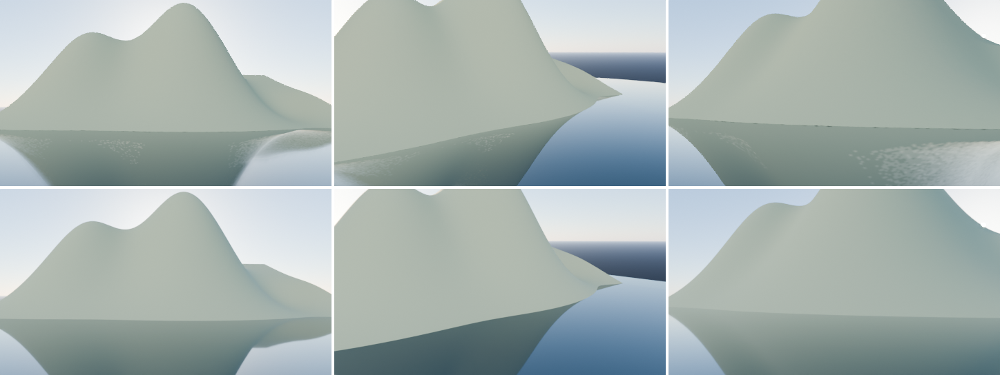

# Baked Engine

静的なBlenderシーンを **「xyz + uv を持つ三角形」と「テクスチャ1枚」だけ** に焼き込む、パストレーシングベースのベイクエンジンです。Blenderのアドオンとして動作します。

ライティングだけでなく **三角形もベイク対象** です。海に映る山のような反射は、カメラ位置に依存しない「鏡像ジオメトリ」として出力されるため、出力メッシュの中をどこから見ても反射が正しく見えます。



*上段: 元のシーンをCyclesでレンダリング。下段: ベイク結果（xyz+uvの三角形とテクスチャ1枚だけを、ライティングなしで描画）。3つの視点のうちベイク時の参照カメラは左のみで、他の2視点でも山の映り込みが一致しています。*

## インストール

Blender 4.2 以降（5.2で動作確認）。

```bash
scripts/build_extension.sh /Applications/Blender.app/Contents/MacOS/Blender
```

`dist/baked_engine-0.1.0.zip` ができるので、Blender の *Edit > Preferences > Get Extensions > Install from Disk* でインストールします。

## 使い方

1. **Properties > Render > Baked Engine** でテクスチャサイズ（幅・高さ）を決めます。
2. 必要なら反射させたいオブジェクトの **Properties > Object > Baked Engine** で反射モードを設定します（既定の Auto で、平らで光沢のある面は自動的にジオメトリ反射になります）。
3. **Bake** を押します。進捗はパネルに表示され、Esc で中断できます。

結果は `Baked Engine` コレクションにプレビューオブジェクト（UV 1つ + 無照明マテリアル1つ）として作られ、出力フォルダに書き出されます。

### コマンドライン

```bash
blender -b scene.blend --python scripts/bake_blend.py -- --size 2048 --samples 256 --out ./baked
```

## 出力

| ファイル | 内容 |
|---|---|
| `name.glb` | 1メッシュ・1マテリアル（KHR_materials_unlit）、PNG埋め込み |
| `name.obj` + `.mtl` | 頂点座標 `v`、UV `vt`、三角形 `f` |
| `name.bkd` | 生バイナリ: `"BKD1"`, 頂点数, インデックス数, 幅, 高さ, `float32[x y z u v]`, `uint32` インデックス, RGBA8 画像（上の行から） |
| `name.png` | ベイクテクスチャ（RGBA、Aはアルファ切り抜き） |
| `name.hdr` | リニアHDRのテクスチャ（任意） |
| `name.json` | テクセル密度、三角形数、反射面などの統計 |

- 座標系は既定で Y-up（glTF/OBJ慣習）。Blenderと同じ Z-up も選べます。
- 三角形は反時計回りが表面です（鏡像ジオメトリも向きを補正済み）。バックフェースカリングを推奨します。
- テクスチャは **シーンのビュー変換（AgX等）を通した表示用の色** です。リニア値が必要なら `.hdr` を使ってください。
- アルファは葉などの切り抜き用です（0.5 でクリップ）。

## しくみ

### 1. アトラス（テクスチャ1枚に収める）

- 全三角形を投影方向ごとに連結成分へ分けてチャート化し、**ワールド単位で平坦化**します。そのためシーン全体でテクセル密度がほぼ均一になります。
- パッキングはスカイライン法。指定された画像サイズに **収まる最大のテクセル密度を二分探索** します。
- テクセル密度（texels/m）を指定した場合、収まらなければ **自動的に密度（解像度）を下げます**。パディングも足りなければ段階的に詰め、それでも無理な場合だけエラーにします。
- 保守的ラスタライズ（境界をまたぐテクセルも必ず焼く）＋ パディング領域の膨張・プルプッシュ充填で、バイリニア補間やミップマップでの継ぎ目を防ぎます。

### 2. ライティング（パストレーシング）

2つのエンジンを選べ、結果は同じ単位系です（下記の検証参照）。

- **Cycles**（既定）: アトラス用のUVを持つ一時プロキシメッシュに元マテリアルの複製を割り当て、Cyclesでベイクします。Blenderのマテリアル機能がすべて効き、GPUも使えます。シード違いで2回ベイクして分散を推定し、デノイズに使います。
- **Built-in**: numpy だけで書かれた独自パストレーサ。SAH-BVH、Lambert + GGX、ポイント/スポット/サン/エリアライト、発光メッシュ、HDRI重要度サンプリング（MIS）、ロシアンルーレット、R2低食い違い列、壁の中に埋まったテクセルの光漏れ検出。

どちらも「照明だけ」を焼き（アルベドで割った状態）、エッジ保存型 à-trous ウェーブレット（位置・法線・分散で境界を判定）でデノイズしてからアルベドを掛けるので、テクスチャの細部はぼけません。

### 3. 三角形のベイク: ジオメトリとしての反射

平面鏡に映る像は「平面で折り返したシーン」そのもので、**視点に依存しません**。これを利用します。

海と山の例では:

1. 海（光沢のある平面パッチ）を検出し、出力からは **取り除いて「窓」** にします。窓の奥に見えてはいけない海底なども取り除きます。
2. 海面より上にあるもの（山）を **海面で分割（クリップ）して上側だけ残し、上下反転して海面の下に配置** します。窓の外から見えないよう、反射ボリュームでクリップします。
3. その鏡像の山には **2つ目のテクスチャ領域**（同じアトラス内）を割り当て、**海の色とフレネルで混ぜ、粗さに応じてぼかした** 色を焼きます。
   - ぼかしは鏡像の山の各点から反射方向の周りに光線を集める方式なので、山の輪郭は背後の空と自然に混ざります。
   - 海自身の色（拡散成分）と、参照視点から見たフレネル係数で混ぜます。
   - 太陽やライトの映り込み（グリント）も解析的にぼかして焼きます。
4. 鏡像の空として、海の下に **空のドーム** を置きます（遠方クリップに収まるよう、シーンをちょうど包む半径）。

カメラが海面のどこへ移動しても、窓越しに鏡像ジオメトリが見えるので、反射は正しい位置に映ります。

#### 複雑な反射

- **複数の反射面**: 同一平面上の面（複数の水たまり、窓ガラスの列など）は1つの鏡世界にまとめます。
- **鏡の中の鏡**: 向かい合う鏡は再帰的に（`Mirror Depth`）鏡像を作ります。上限を超えた鏡は鏡像内で不透明な面として描きます。
- **波のある水面**: 全体として平面に近いオブジェクトは1枚の鏡にまとめ、波の傾きのばらつきをぼかし量に加えます。
- **曲面・凸な光沢物体**（球、光沢のある箱など）や小さな面: ジオメトリ反射だと隣の面の鏡世界が透けて見えてしまうため、**参照視点（シーンカメラ）から見た反射をテクスチャに焼く** 方式に自動で切り替えます。平面でない金属も同様です。
- **枠のない鏡**: 鏡の縁が壁などで隠れていない辺は、参照カメラから見える範囲に鏡像をクリップし、鏡の外に鏡像がはみ出して見えるのを抑えます。

## 検証

`tests/` の pytest（Blender不要）と `tests/blender/`（Blender内で実行）があります。

```bash
python -m pytest
scripts/run_blender_tests.sh /Applications/Blender.app/Contents/MacOS/Blender
```

- 積分器: ファーネステスト（閉じた発光箱の多重反射 = Le/(1-ρ)）、HDRI重要度サンプリング、各ライトの物理単位。
- **Cyclesとの一致**: サン・ポイント・スポット・エリア・ワールド色・Nishita空・発光メッシュで、Built-in と Cycles のベイク結果が 1% 以内で一致。
- ワールド変換: HDRI＋マッピング回転、任意のワールドシェーダのキャプチャ方向がCyclesと一致。
- **反射**: ベイク結果を参照カメラ以外の視点からレンダリングし、元シーンのパストレース（実際の鏡面反射）と比較。鏡の中の鏡、凸物体の扱い、波の水面。
- アドオン: オペレータの実行、両エンジンでの書き出し、一時データの後片付け。

## 制限事項

- 視点に依存する効果（金属や曲面の反射、ガラスの屈折）は参照視点からの見え方で近似されます。透過（ガラス）は不透明な光沢面として扱います。
- ジオメトリ反射は「鏡の奥の空間を占有する」ので、壁に掛かった鏡の裏に別の部屋がある場合などは自動的にテクスチャ反射になります（`Clear Behind` / `Max Depth` で調整可能）。何にも囲まれていない自立した鏡は、参照カメラから離れた視点では鏡像が縁からはみ出して見えることがあります。
- マテリアルの抽出（Built-inエンジン・反射計算用）は Principled / Diffuse / Glossy / Emission と画像テクスチャに対応し、複雑なノードは近似します。Cyclesエンジンのライティングは元マテリアルそのものを使います。
- 出力テクスチャは1枚なので、シーンが大きいほどテクセル密度は下がります（統計の `texel_density` で確認できます）。

## 構成

```
baked_engine/
  core/          bpy に依存しない本体（numpy のみ）
    pipeline.py    全体の流れ
    reflections.py 反射面の検出、鏡像ジオメトリ、反射テクセルのシェーディング
    atlas.py       チャート化とパッキング      raster.py  保守的ラスタライズ
    integrator.py  パストレーサ                bvh.py     BVHとベクトル化レイトレース
    imageops.py    デノイズ・膨張・色変換      export.py  glb/obj/bkd/png/hdr
  blender/       アドオン（UI、シーン抽出、Cyclesバックエンド、ワールドキャプチャ）
scripts/         ビルド、Blenderテスト、コマンドラインベイク
```

## ライセンス

MIT
